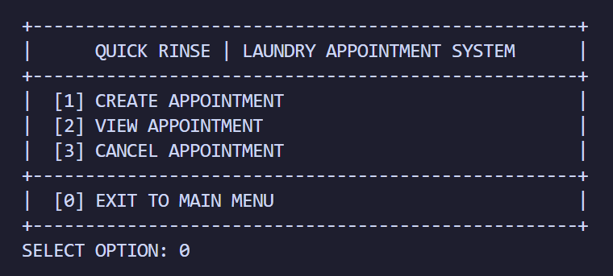

# Laundry Appointment Management System

A console-based laundry management and booking application developed as a project fulfillment for **Object-Oriented Programming and Information Management**.

The system streamlines the monitoring of pickup and delivery laundry appointments, machine allocation, and payment processing using a layered OOP architecture, with real business logic in accordance with client demands.

## Tech Stack Used
1. **Java** (JDBC, Maven)
2. **MS SQL Server**

## Key Features
- **Portable Database Connection & DAO Layer:** Connects to MS SQL Server via JDBC using externalized credentials (`config.properties`) for easy multi-device setup and secure version control. Implements the Data Access Object (DAO) pattern to encapsulate full CRUD operations and atomic transaction rollbacks across relational tables.

- **Modular Console UI:** Built with a clean, uniform ASCII box layout (`+`, `-`, `|`) using `String.format()` alignment, shared input `Scanner` management, and interactive validation loops across dedicated menu classes (`MainMenu`, `BookingMenu`, `StaffLoginMenu`, `AttendantMenu`, and `DeliveryRiderMenu`).

- **Customer Booking Module:** Create Walk-In or Delivery appointments, view real-time order status and billing, generate digital payment QR codes, and cancel pending bookings

- **Laundry Attendant Module:** Weigh laundry loads, automatically compute required machines, assign specific physical washers/dryers, monitor all appointments, and track estimated completion times.

- **Delivery Rider Module:** View assigned delivery appointments, update delivery statuses (`Out for Delivery`, `Completed`), and process cash or digital payments.

- **Role-Based Staff Authentication:** Authenticates staff credentials against the database and uses polymorphism to dynamically route users to either the Laundry Attendant or Delivery Rider menu.

- **Machine Inventory & Status Tracking:** Monitors real-time operational states (`Available`, `In Use`, `Under Maintenance`) for washers and dryers, automatically locking assigned machines during active cycles and releasing them upon completion.

## Code Snippets
#### Customer Appointment Menu

  

